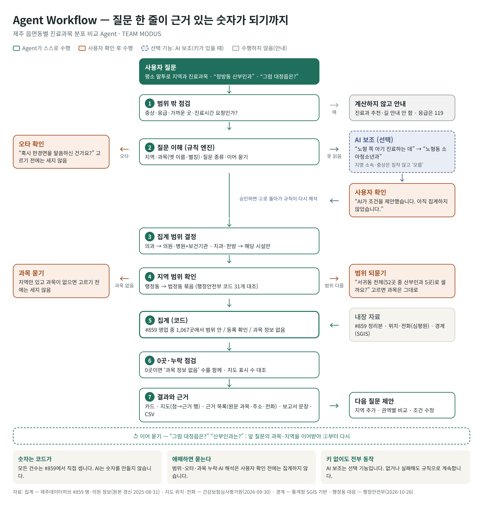

# 제주 읍면동별 진료과목 분포 비교 Agent

TEAM MODUS · 제주 AI·빅데이터 활용 AI Agent 개발 챌린지 출품작 (2026-11-17 제출)

제주 읍·면·동마다 어떤 진료과목을 등록한 병·의원이 몇 곳 있는지 평소 말투로 물으면, 같은 기준으로 세고 근거 목록·지도·보고서 문장·CSV까지 보여 주는 로컬 Agent입니다. 필수 데이터는 제주데이터허브 #859 [보건, 복지] 병·의원 정보입니다.



> **이 저장소와 대회 제출본의 차이:** 대회에 낸 ZIP에는 설치 없이 실행되도록 Python 3.12.12 실행 파일(`python/` 폴더, 약 34MB)과 평가용 API 키가 들어 있습니다. 이 저장소에는 둘 다 넣지 않았습니다. `python/` 폴더에는 라이선스 안내만 있고, `평가용_API키.txt`는 빈 양식입니다. 코드·자료·문서는 제출본과 같습니다.
>
> 기획서: [`docs/00_기획서_TEAM_MODUS.pdf`](docs/00_기획서_TEAM_MODUS.pdf)

## 1. 실행
이 저장소에서 실행하려면 PC에 **Python 3.10 이상**이 설치되어 있어야 합니다(외부 패키지는 필요 없음). `run.bat`은 `python\python.exe`가 없으면 설치된 `python` 또는 `py -3`로 실행합니다. Windows가 아니면 `python3 jeju_med/server.py`.


1. ZIP을 원하는 폴더에 풉니다. 폴더 이름에 한글이 있어도 됩니다.
2. `run.bat`을 더블클릭합니다. 검은 실행 창이 뜨고 약 1초 뒤 브라우저(크롬·엣지)가 열립니다.
   브라우저가 열리지 않으면 주소창에 `http://127.0.0.1:8765`를 입력합니다.
3. **첫 실행 확인:** 예시 버튼 "한경면에 소아청소년과 있어?" → 범위 안 9곳 · 등록 확인 3곳 · 과목 정보 없음 6곳이면 정상입니다.
4. 끝낼 때는 검은 실행 창을 닫습니다.

자세한 화면 사용법은 `docs/01_실행환경_매뉴얼.pdf`에 있습니다.

## 2. 실행 환경과 의존성

| 항목 | 내용 |
|---|---|
| 운영체제 | Windows 10/11 64비트 (센터 PC: Windows 11, i7-8700, RAM 32GB에서 충분) |
| 브라우저 | 크롬 또는 엣지 |
| 실행 환경 | `python/` 폴더에 Python 3.12.12 동봉 (python-build-standalone, Windows x64). 별도 설치·관리자 권한 불필요 |
| 외부 패키지 | **없음** (pip 설치 0개). 표준 라이브러리만 사용: csv, json, os, re, sys, threading, http.server, urllib.request, webbrowser |
| 인터넷 | 필요 없음 (지도도 내장 경계 자료로 그림). 선택 기능인 AI 보조를 켤 때만 사용 |
| 그래픽카드·GPU | 필요 없음 |
| 디스크 | 제출본 압축 해제 시 약 35MB (이 저장소는 약 2MB + 문서) |
| 네트워크 노출 | `127.0.0.1:8765` — 이 PC 안에서만 접속, 외부에 열리지 않음 |

`run.bat`은 `python\python.exe`가 있으면 그것을, 없으면 PC에 설치된 `python` 또는 `py -3`를 사용합니다.

## 3. 환경변수·설정 (모두 선택)

키가 없어도 모든 기능이 동작합니다. 아래는 필요할 때만 설정합니다.

| 이름 | 용도 | 기본값 |
|---|---|---|
| `OPENAI_API_KEY` | AI 보조(질문 고쳐 쓰기)에 OpenAI 사용 | 없음 |
| `ANTHROPIC_API_KEY` | AI 보조에 Anthropic 사용 | 없음 |
| `JEJU_MED_OPENAI_MODEL` | OpenAI 모델 | `gpt-4o-mini` |
| `JEJU_MED_ANTHROPIC_MODEL` | Anthropic 모델 | `claude-haiku-5-5` |
| `JEJU_MED_LLM_MAX_CALLS` | 한 번 실행 중 AI 호출 최대 횟수(과다 호출 방지용, 총비용 한도는 아님) | `200` |
| `JEJU_MED_PORT` | 사용 포트 (8765가 사용 중일 때) | `8765` |

예시는 `환경변수_예시.txt`에 있습니다. 키는 Windows 환경변수로 넣거나, 맨 위 폴더의 `평가용_API키.txt`에 적습니다(대회 규정상 심사용 키만 이 파일로 제출 가능). 환경변수가 있으면 환경변수가 먼저 쓰입니다. 프로그램은 키를 별도로 저장하거나 화면·로그에 출력하지 않습니다.

## 4. Agent 구성 요약

- **판단 단계:** 질문 이해 → 범위 결정(셀 시설 종류) → 지역 확인(행정동·법정동, 모호하면 되묻기) → 집계(범위 안 / 등록 확인 / 과목 정보 없음) → 0곳·누락 점검 → 다음 질문 제안
- **자동 수행:** 명확한 질문 해석, 확정 조건 집계, 누락 점검, 지도·근거 목록·보고서 문장 생성
- **사용자 확인 후 수행:** 모호한 지역 범위(예: 정방동 → 서귀동 전체), 오타 후보(예: 한깅면 → 한경면)
- **수행하지 않음:** 증상 상담·진료과 추천, 가장 가까운 병원·길 안내, 진료시간·예약, 응급 판단
- **규칙과 AI:** 질문은 규칙(기본)과 선택적 LLM으로 해석하고, 확정된 조건의 집계는 코드가 합니다. LLM은 규칙으로 읽지 못한 질문을 표준 질문 문장으로 고쳐 쓰기만 하고, 그 결과도 다시 규칙이 확인합니다.
- **Prompt 원문:** `jeju_med/llm.py`의 `PROMPT` 상수 (결과 설명자료에도 전문 수록)

## 5. 폴더 구성

| 경로 | 내용 |
|---|---|
| `run.bat`, `실행방법.txt` | 실행 파일, 짧은 설명 |
| `README.md` | 이 문서 |
| `AI연결_점검.bat` | (선택) 평가용 키로 AI 보조가 응답하는지 점검(키 값은 출력하지 않음) |
| `환경변수_예시.txt`, `평가용_API키.txt` | 설정 예시, 심사용 키 파일(비어 있으면 키 없이 동작) |
| `jeju_med/engine.py` | 계산 엔진: 질문 해석, 범위 결정, 되묻기, 집계, 점검, 보고서 문장 |
| `jeju_med/server.py` | 로컬 웹 서버(표준 라이브러리 http.server) |
| `jeju_med/llm.py` | (선택) AI 보조: Prompt, OpenAI·Anthropic API 호출, 실패 시 규칙 해석 유지 |
| `jeju_med/static/` | 화면(index.html), 지도 경계(jeju_map.json) |
| `jeju_med/data/` | #859 정리본, 지도 위치·전화번호, `출처와_라이선스.txt` |
| `jeju_med/tests/test_questions.py` | 자동 시험 40개 |
| `jeju_med/tools/` | 자료를 만든 스크립트(좌표 연결 match.py, 검증 verify.py, 지도 build_map.py) |
| `python/` | (제출본) 동봉 Python 3.12.12 — 이 저장소에는 라이선스 안내만 포함 |
| `docs/` | 실행환경·매뉴얼, 데이터 활용 명세, 결과 설명자료, 자동 시험 부록 (PDF) |

## 6. 데이터·외부 자료·오픈소스

| 구분 | 내용 | 이용조건 |
|---|---|---|
| 필수 데이터 | 제주데이터허브 #859 [보건, 복지] 병·의원 정보 (공개 API, 2026-11-10 수집, 원본 갱신 2025-08-31). 영업·정상 1,067건 정리본 | 제주데이터허브 공개 데이터. 전처리본 포함은 운영진 답변(2026-11-06)에 따름 |
| 외부 데이터 | 건강보험심사평가원 전국 병의원 및 약국 현황 (2026-09-30) — 지도 위치·기관 전화번호에만 사용 | 공공누리 제1유형(출처표시) |
| 외부 데이터 | 행정동 경계 vuski/admdongkor ver20250701 (통계청 SGIS 기반) — 지도 바탕 | 공공누리 제1유형 + CC BY 4.0 |
| 외부 데이터 | 행정안전부 행정기관(행정동) 및 관할구역(법정동) 코드 (2026-10-26) — 행정동 묶음 검증 | 행정안전부 공개 자료 |
| 오픈소스 | Python 3.12.12 | PSF License (`python/LICENSE.txt`) |
| 오픈소스 | python-build-standalone (설치 없이 실행되는 Python 배포본) | 빌드 도구 MPL-2.0. 포함 구성요소: OpenSSL 3(Apache-2.0), libffi(MIT), SQLite(Public Domain) 등 — `python/라이선스_안내.txt` |
| 외부 API (선택) | OpenAI Chat Completions 또는 Anthropic Messages | 각 서비스 이용약관 |
| 외부 코드 | 없음 (그 밖의 라이브러리·복사 코드 없음) | — |

대회 제공 「제주데이터허브 데이터 목록」 엑셀은 사용·포함하지 않았습니다.

## 7. AI 활용 내역

- **실행 중 (선택):** OpenAI `gpt-4o-mini` 또는 Anthropic `claude-haiku-5-5` — 규칙으로 읽지 못한 질문의 표준 문장 고쳐 쓰기에만 사용. 숫자 계산·보고서 문장 생성에는 쓰지 않음.
- **개발 중:** Claude(Anthropic) — 데이터 점검, 코드·시험·문서 초안 작성. ChatGPT(OpenAI) — 설계·결과·표현 검토. 주제와 집계 기준 결정, 결과 검토, 최종 채택은 TEAM MODUS가 했습니다.

## 8. 자동 시험

```
python\python.exe jeju_med\tests\test_questions.py
```

마지막 줄에 `ALL PASS`가 나오면 정상입니다. 집계 시험의 기대값은 계산 엔진을 쓰지 않고 자료 파일을 직접 세는 별도 코드로 계산하고, 해석·되묻기 시험은 미리 정한 기대 동작과 대조합니다.

## 9. 오류·제약사항

| 증상·제약 | 대응 |
|---|---|
| Windows 보안 안내(“PC 보호”) | [추가 정보] → [실행]. 관리 PC에서 막히면 담당자에게 실행 허용 확인 |
| 브라우저가 열리지 않음 | 주소창에 `http://127.0.0.1:8765` |
| 포트 사용 중·창이 바로 닫힘 | 이미 실행 중인 창을 닫거나 `JEJU_MED_PORT`를 다른 번호로 |
| AI 보조 호출 실패(키 오류·인터넷 없음·호출 한도) | 자동으로 규칙 해석 결과를 사용. 숫자에는 영향 없음 |
| 등록 과목 ≠ 실제 진료 | 화면의 모든 표현을 “등록 확인”으로 통일. 원문 과목을 근거 목록에 표시 |
| 큰 병원의 과목 미기입 | ‘과목 정보 없음’을 따로 세어 함께 표시 |
| 기준일 | #859 원본 갱신 2025-08-31. 이후 개·폐업 미반영 |
| 지도 | 1,067곳 중 982곳 표시. 나머지는 목록에만 표시(위치 미확인·보류 사유 명시) |
| 지표 | 건수만 제공(인구·거리 미반영) |

## 10. 키를 넣을 때 주의 (이 저장소를 내려받은 경우)
`평가용_API키.txt`에 키를 적은 뒤에는 그 파일을 **커밋하지 마세요**. 환경변수로 넣는 방법을 권합니다.
